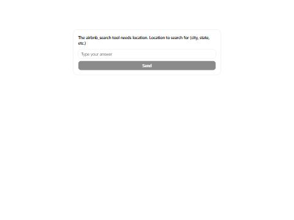

# Airbnb Bridge

This repo has a client and a FastMCP bridge server for the Airbnb MCP server.
The bridge exposes the upstream tools. It asks the user for a missing required input through Generative UI.

## Install

You need Python 3.11 or newer, Node with npx, and uv.

```bash
uv venv .venv
```

```bash
uv pip install --python .venv/Scripts/python.exe -r requirements.txt
```

The Generative UI sandbox needs Deno. The requirements file installs Deno in the virtual environment.
The first question takes about 20 seconds, because the sandbox loads Pyodide from a CDN.

## Run

List the upstream tools and call the first tool with sample values.

```bash
.venv/Scripts/python.exe client.py
```

Serve the bridge on stdio.

```bash
.venv/Scripts/python.exe server.py
```

Point the client at the bridge. Pass a tool name from the list. Empty arguments cause a question.

```bash
.venv/Scripts/python.exe client.py --target server.py --tool TOOL_NAME --args "{}"
```

Run the tests. All tests that touch a server use the live upstream server, so they need network access.

```bash
.venv/Scripts/python.exe -m pytest test_client.py test_server.py -q -rs
```

## How a question works

1. A call reaches a bridge tool. The exposed schema has no required list, so a partial call gets through.
2. The bridge reads the upstream schema and finds the first missing required input.
3. The bridge builds one question from that schema. An enum gives tappable options. Any other input gives free text.
4. The provider tool `generate_prefab_ui` renders the question.
5. The user answers. The host sends the answer to the model as a chat message.
6. The model calls the tool again with the answer. The bridge forwards a complete call to the upstream server.
7. The bridge returns the upstream text and a card that shows the text in a UI host.

The bridge holds one upstream session while it serves. A forwarded call does not start a new upstream process.

## Tool list

This list comes from a real run on 31 October 2026. The bridge reads the names at runtime.

| Tool | Source | Required input |
|---|---|---|
| `airbnb_search` | Upstream | `location` |
| `airbnb_listing_details` | Upstream | `id` |
| `generate_prefab_ui` | Generative UI provider | `code` |
| `search_prefab_components` | Generative UI provider | None |

## Generative UI question

This text comes from a real run of the client against the bridge, with empty arguments.

```text
CALL airbnb_search {}
IS_ERROR False
HAS_UI True
Clarifying question: The airbnb_search tool needs location. Location to search for (city, state, etc.) Call airbnb_search again with these inputs: {}. Set location to the answer.
```

The same question looks like this in the Prefab renderer.



## Known limits

The last run gave 17 passed and 2 skipped.

Airbnb redirects this network to a local domain. The upstream server does not follow that redirect, so both upstream tools return an error and no data. Version 0.3.0 of the upstream package fails in the same way. The two skipped tests check for real data. They run in full on a network that Airbnb does not redirect. They skip only when a direct request to Airbnb shows the redirect.

The answer step has not run in a real MCP Apps host. The renderer showed the question and the result card in a browser, but no host received the answer message.

A forwarded result gets a card only when the upstream result has no structured content. The current upstream tools return text only.
